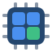
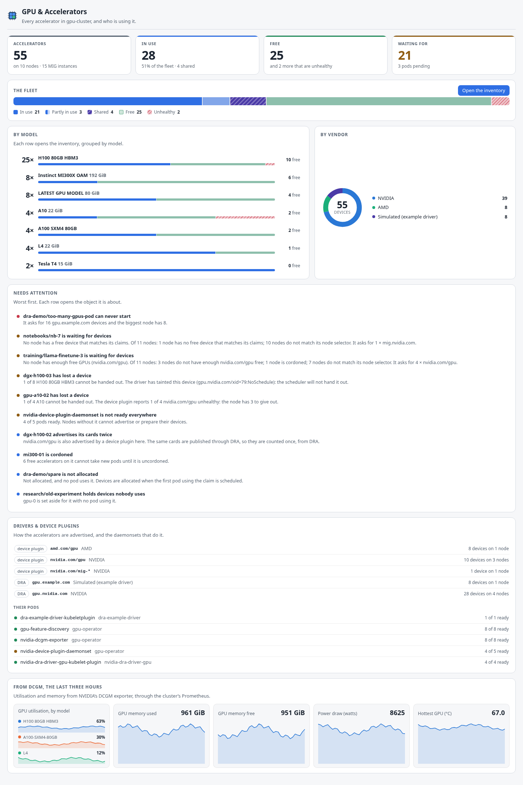
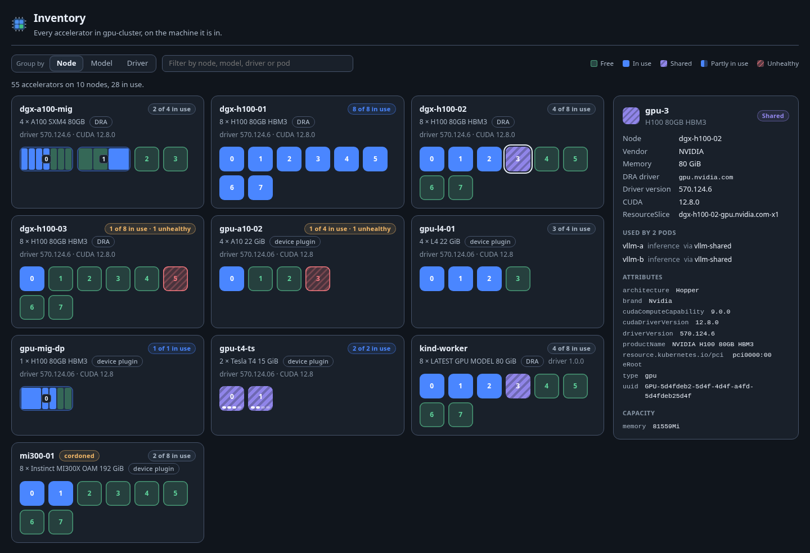
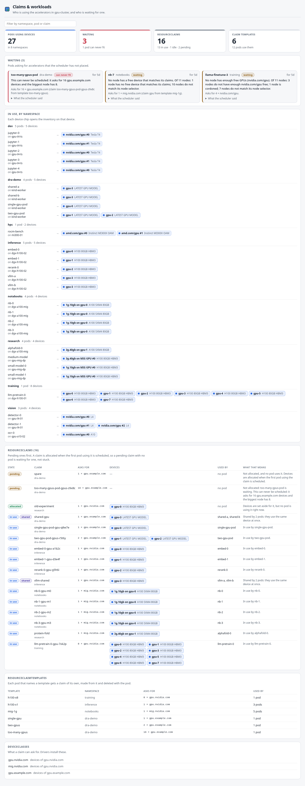
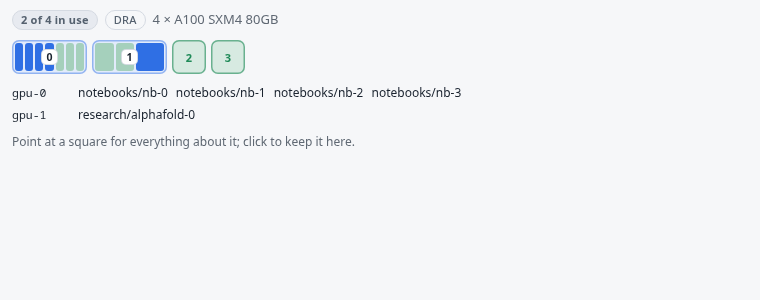
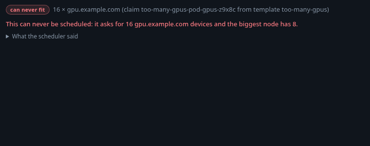
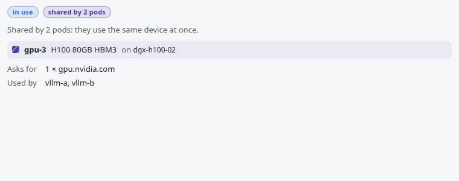

# GPU & Accelerators for K8s Dockside

A [K8s Dockside](https://github.com/k8sdockside/k8sdockside) plugin for the
GPUs and other accelerators in a cluster — whichever way they are handed out:
through a **device plugin** (`nvidia.com/gpu: 2` in a pod's limits) or
through **Dynamic Resource Allocation** (a ResourceClaim allocated named
devices from a driver's ResourceSlices, GA in Kubernetes 1.34).

It answers the questions you open a GPU cluster for — how many are there,
how many are free, who has them, and why is my pod still Pending — without
reading node capacity by hand or decoding a scheduler message.

<!-- markdownlint-disable-next-line MD033 -->




## It counts both paths, once

A cluster can use both ways at once, and they describe the same cards
differently. The plugin puts them into one fleet:

| | Where the devices come from | What it can say about who has one |
| --- | --- | --- |
| **Device plugin** | the node's `status.capacity` and `allocatable`: `nvidia.com/gpu`, `nvidia.com/mig-*`, `amd.com/gpu`, `gpu.intel.com/i915`/`xe`, `habana.ai/gaudi`, `aws.amazon.com/neuron`, `google.com/tpu` | how many each pod asked for, never which card — so those squares are filled in order, and the page says so |
| **DRA** | the ResourceSlices each driver publishes (`gpu.nvidia.com`, `gpu.example.com`, …), newest pool generation only | exactly: which devices each claim was allocated, and which pods it is reserved for |

What keeps the numbers honest, each covered by a test in `src/model/`:

- A node whose DRA driver publishes a vendor's cards is not counted again
  through that vendor's extended resource — running both is a migration
  state, and the page says the node advertises its cards twice.
- **MIG** instances are cells of a GPU, not GPUs. From DRA each instance names
  its GPU (`parentUUID`); from the device plugin they are packed onto as few
  cards as their compute slices fit (7 per card, 4 on an A30).
- **Time-slicing** is divided back out using GFD's `nvidia.com/gpu.replicas`
  label: 8 advertised on a node with 2 cards shared 4 ways is 2 cards with 4
  slots each.
- A card the device plugin dropped from `allocatable`, or that a DRA driver
  tainted, is drawn as there-but-unhealthy — that is how a lost GPU shows up.
- Intel's `gpu.intel.com/millicores` and `memory.max`, Neuron cores, and
  NVIDIA's compute-domain channels are fractions or not accelerators at all,
  and are left out.

## What it shows

**Dashboard** — four big tiles: accelerators, in use, free, and what pending
pods are waiting for. The whole fleet as one bar (in use, partly used by MIG,
shared, free, unhealthy); every model as a row — `25× H100 80GB HBM3`, with
its own bar and how many are free; the vendors as a ring. Then **needs
attention**, worst first, each row opening its object: pods that can never be
scheduled (asking for more than the biggest node has), pods waiting for
devices with the scheduler's reason in words, nodes that have lost a GPU,
devices a driver has tainted, driver and device-plugin daemonsets that are
not ready, nodes that are NotReady or cordoned with free cards, claims that
hold devices no pod uses. Then every DRA driver and device-plugin resource
with its node and device counts, their daemonsets, and — with a Prometheus —
the DCGM charts.

**Inventory** — every accelerator as a square on its node, coloured free, in
use, shared (one claim used by several pods, or time-sliced), partly in use
or unhealthy. A GPU split into MIG instances is drawn as cells across the
square, each as wide as its compute slices; a time-sliced card has a slot
mark per replica along its foot. Point at a square and the inspector shows
its model, memory, driver and CUDA version, every attribute and capacity its
DRA driver publishes, its ResourceSlice, and the pods using it and the claim
they use it through — each a link. Group by node, model or driver; filter by
any of those or by a pod's name.



**Claims & workloads** — the same from the pods' side. Waiting pods first,
each with why in plain words ("No node has enough free GPUs
(nvidia.com/gpu). Of 11 nodes: 3 nodes do not have enough nvidia.com/gpu
free; 1 node is cordoned; …")
and the scheduler's own sentence under it. Then every namespace, its pods,
and the devices each holds (a chip opens the Inventory on that device); every
ResourceClaim with its state — pending, allocated, in use, shared — and what
that state means here; the ResourceClaimTemplates and how many pods use each;
and the DeviceClasses.



**Panels** on Nodes (the node's device grid and who holds what — the
question before a drain), on Pods (the devices it has, or what it is waiting
for and why) and on ResourceClaims (what it asked for, the devices it was
given and on which node, the pods using it, and the template it came from).

| Node | Pod | ResourceClaim |
| --- | --- | --- |
|  |  |  |

The four DRA kinds also get their own tables in the sidebar, plus the nodes
GFD labels `nvidia.com/gpu.present=true`.

Every page is also shot in the other theme in
[`docs/screenshots/`](docs/screenshots/).

## What it reads, and what it changes

It reads Nodes, Pods, DaemonSets and Events, and the `resource.k8s.io` kinds
— ResourceSlices, ResourceClaims, ResourceClaimTemplates and DeviceClasses —
at whatever version the cluster serves (`v1` from 1.34; the `v1beta1` shape
of 1.32 is read too). On a cluster that does not serve `resource.k8s.io` at
all it says so and works from the device plugins alone. Events are read only
for the scheduler's `FailedScheduling` message when a pod's condition has
none. It never reads Secrets: the app refuses that for every plugin.

**It changes nothing.** There are no actions and the manifest does not ask to
write.

### Charts

Five overview charts, drawn from the cluster's Prometheus if it scrapes
NVIDIA's [DCGM exporter](https://github.com/NVIDIA/dcgm-exporter) (the GPU
Operator installs it): utilisation by model, framebuffer memory used and
free, power draw and the hottest GPU's temperature. A utilisation chart is
also attached to every Node (`Hostname="$node"`) and every Pod (DCGM's pod
mapping, as `pod` or `exported_pod`). Without a Prometheus the dashboard
says so; with one and no DCGM it says that, and names fake-gpu-operator for
trying it without a GPU.

## Installing

In K8s Dockside: **Settings → Plugins → From a repository**:

```text
https://github.com/k8sdockside/gpu.git
```

Needs K8s Dockside 0.1.12 or newer. It works on any cluster — `nodes` is its
only required kind — and says plainly when a cluster has no accelerators.

## Testing without a GPU

You do not need one. [`dev/`](dev/README.md) has three ways, from none to a
real scheduler:

- **`npm run preview`** draws every page against `src/fixtures.ts` in both
  themes — H100s through NVIDIA's DRA driver, static MIG, L4, A10,
  time-sliced T4 and mixed-MIG nodes through the device plugin, an AMD node,
  the DRA example driver's simulated GPUs, a shared claim, a lost GPU, a
  tainted device, and pending pods. No cluster at all.
- **`dev/kind-dra.sh`** creates a kind cluster with
  [kubernetes-sigs/dra-example-driver](https://github.com/kubernetes-sigs/dra-example-driver)
  (8 simulated GPUs, `gpu.example.com`) and sample workloads: one GPU, two
  GPUs, a claim shared by two pods, and a pod that asks for 16.
- **`dev/kwok-fleet.sh`** adds a [KWOK](https://kwok.sigs.k8s.io) fleet: 6 × 8
  fake H100s and an A100 MIG node through hand-written ResourceSlices, L4 and
  time-sliced T4 nodes through fake `nvidia.com/gpu` capacity, and workloads
  the real scheduler places on them.

For the charts, run.ai's
[fake-gpu-operator](https://github.com/run-ai/fake-gpu-operator) emits
DCGM-named utilisation and memory metrics on CPU-only nodes. See
[`dev/README.md`](dev/README.md) for each, and for what has and has not been
verified.

## Working on it

The pages are TypeScript in `src/`, bundled into `ui/` — which is what the app
serves, and what installing clones, so `ui/` is committed and must be in step
with `src/`.

```sh
npm install
npm run build     # src/ -> ui/
npm run watch     # rebuild on every change; reopen the tab to see it
npm run preview   # draw every page to preview/, with no cluster
npm run check     # typecheck, unit tests, and ui/ against a fresh build
```

To see your changes in the app without installing anything: **Settings →
Plugins → Watch another folder**, point it at this checkout, and press
**Reload** after each build.

To check the manifest the way the app does:

```sh
go run github.com/k8sdockside/k8sdockside/cmd/plugincheck@v0.1.12 .
```

### How it is laid out

| | |
| --- | --- |
| `plugin.json` | the manifest: views, charts, panels |
| `src/model/` | what the objects mean — vendors and MIG profiles, DRA slices and claims, the inventory, who is waiting and why — with the tests |
| `src/ui/` | the pieces the pages are drawn from: the device grid and inspector, tiles, rings, bars, charts |
| `src/pages/` | one `.ts` and one `.html` per page, plus `render.test.ts` |
| `src/styles/` | one stylesheet, written in the app's theme tokens only |
| `dev/` | clusters to test against, with no GPU |

Cluster data goes on the page as text, never as HTML: there is no
`innerHTML` anywhere in `src/`, and the render test feeds a node named
`` through the inventory to prove it.

The DRA field names in `src/model/kube.ts` are the JSON tags in
`k8s.io/api/resource/v1`; the NVIDIA attribute names (`type`, `productName`,
`parentUUID`, `profile`, `driverVersion`, `cudaDriverVersion` …) are the
ones [NVIDIA's DRA driver](https://github.com/NVIDIA/k8s-dra-driver-gpu)
publishes, and the node labels (`nvidia.com/gpu.product`, `.memory`,
`.count`, `.replicas`, `.sharing-strategy`,
`nvidia.com/cuda.driver-version.full` …) are
[gpu-feature-discovery](https://github.com/NVIDIA/k8s-device-plugin)'s.

## Credit

The mark is this plugin's own — a chip with the Inventory's squares on it —
and names no vendor. NVIDIA, AMD, Intel and Gaudi are their owners'
trademarks, used here only to say which hardware the plugin recognises. This
plugin is not affiliated with any of them.

Apache 2.0 — see [LICENSE](LICENSE).
